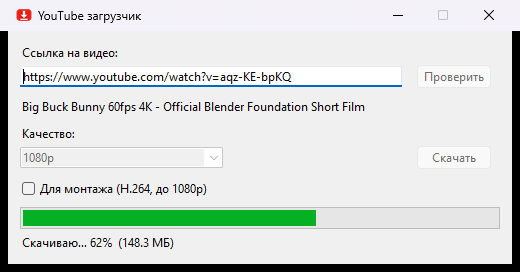

<p align="center">
  
</p>

<h1 align="center">YT Tray Downloader</h1>

<p align="center">
  A tiny Windows app that downloads YouTube videos or audio in one click and quietly lives in your system tray.
</p>

<p align="center">
  
  
  
  
</p>

<p align="center">
  
</p>

## Features

- **Paste, check, download.** Paste a link, press *Check*, pick a quality, press *Download*.
- **Real quality list.** The dropdown shows only the resolutions the video actually has, from 144p up to 4K.
- **Audio only.** One option saves just the sound as MP3.
- **Smart formats.** MP4 + M4A streams come first so files open anywhere on Windows. The video and audio tracks are merged automatically with ffmpeg.
- **Editing mode.** One checkbox switches to H.264 + AAC, the format Premiere Pro and other editors import without trouble. YouTube's default AV1 and VP9 are often rejected. YouTube offers H.264 only up to 1080p, so in this mode the list stops there. The checkbox is remembered between launches.
- **Live progress.** A progress bar with percent and megabytes downloaded.
- **Lives in the tray.** The close button hides the window to the tray. Exit from the tray icon menu.
- **Starts with Windows.** It can launch silently in the tray when you log in.
- **Single instance.** Launching it again just brings up the existing window.
- **Desktop notifications.** You get a notification when a download finishes.
- **Zero idle CPU.** The app does nothing while it waits. No timers and no polling.
- **Keyboard shortcuts in any layout.** `Ctrl+V`, `Ctrl+C`, `Ctrl+X` and `Ctrl+A` work in non-English keyboard layouts too, a classic Tk bug on Windows.
- **Playlist-safe.** A link with `&list=` downloads only that one video, not the whole playlist.

> The interface is in Russian.

## Requirements

| What | Why | Install |
| --- | --- | --- |
| Python 3.10+ | runs the app | [python.org](https://www.python.org/downloads/) |
| ffmpeg | merges video + audio, converts to MP3 | `winget install ffmpeg` |
| Deno | lets yt-dlp solve YouTube's JavaScript challenges, so no formats go missing | `winget install DenoLand.Deno` |
| Python packages | yt-dlp, tray icon | `pip install -r requirements.txt` |

## Installation

```powershell
git clone https://github.com/ShushpanKing/yt-tray-downloader.git
cd yt-tray-downloader
pip install -r requirements.txt
```

Then double-click `yt_downloader.pyw`. Because it is a `.pyw` file, no console window appears.

### Start with Windows (optional)

Press `Win+R`, type `shell:startup`, and create a shortcut there with this target:

```
pythonw.exe "C:\path\to\yt_downloader.pyw" --tray
```

The `--tray` flag starts the app hidden in the tray instead of opening the window.

## Usage

1. Paste a YouTube link and press **Проверить** (Check).
2. Pick a quality, or **Только звук (mp3)** (audio only).
3. Press **Скачать** (Download) and choose a folder.
4. Close the window whenever you like. The download keeps going in the tray, and a notification tells you when it's done.

## Project structure

```
yt_downloader.pyw   the app (Tkinter UI + yt-dlp + pystray)
make_icon.py        draws icon.ico / icon.png with Pillow
icon.ico, icon.png  app icon
requirements.txt    Python dependencies
```

## Keeping it working

YouTube changes things often. If downloads start failing, update yt-dlp first:

```powershell
pip install -U "yt-dlp[default]"
```

## Disclaimer

This tool is for personal use. Download only videos you own, have permission for, or that are under a license that allows it, and follow [YouTube's Terms of Service](https://www.youtube.com/t/terms).

## License

[MIT](LICENSE)
